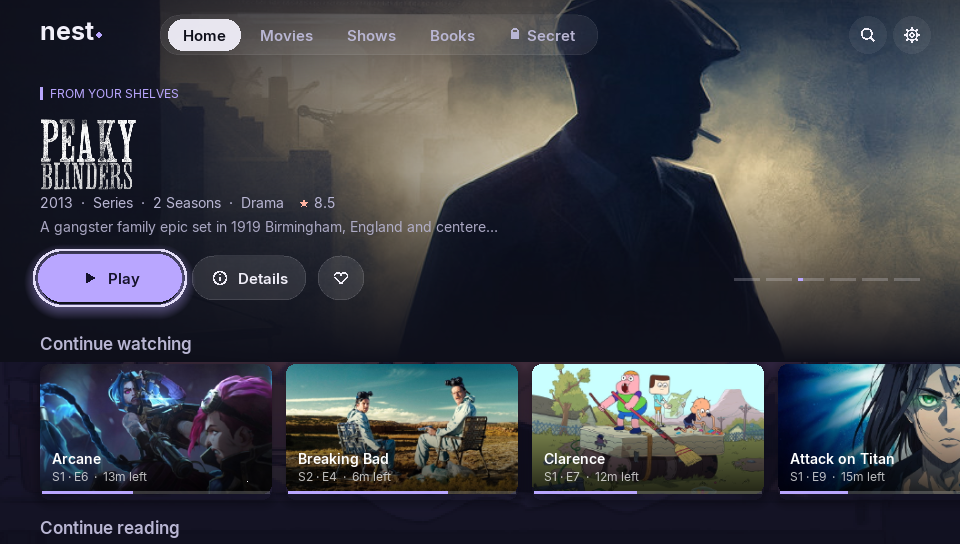

  

<h1 align="center">Nest</h1>

<b>A tiny Netflix for your PS Vita.</b> 
No subscription. No ads. Nobody asking if you're still watching.

  
  
  

Hey, come on in. Get comfy.

It started on a quiet night. Me, my Vita, and a folder of forty files all called something like `Show.S01E07.720p.WEB-DL.x264-FINAL-v2.mp4`. Somewhere around file 23 I thought, *there has to be a nicer way to do this*. There wasn't, so I made one.

That's **Nest**. Put your shows, movies and manga on the memory card, and it quietly turns them into a library that looks and feels like a proper streaming app. No fuss. You just pick something and press play.

## What's inside

🎬 **It looks like a real app.** Big artwork, show logos, *Continue Watching*, *Up Next*, a tab for each season. That lovely Vita screen finally has something worth showing off.

🧠 **It tidies up for you.** Nest reads your file names and works out what's a **movie** and what's a **show**, then puts every episode in the right season. Even the ones with `1080p.BluRay.x264` stuck on the end. It doesn't mind. It's seen worse.

🖼️ **Real posters and logos.** There's a free little PC app called **Nest Metadata** that fetches the actual poster, logo, backdrop and description for everything you have. Drag your folder onto it, make a cup of tea, and come back to a library that looks like it costs money.

🔒 **A private section.** There's a **Secret** tab with a PIN for your more… *personal* "shows". It stays tucked away from the rest of the app. We don't judge, and we definitely don't peek.

📖 **It reads, too.** Manga, comics, PDFs and ePubs. Right-to-left for manga, two pages side by side, and one long scroll for webtoons. Perfect for "one more chapter" turning into six.

⏭️ **The small, nice things.**
- **Skip intro.** Mark it once and R skips it on every episode.
- **It remembers where you stopped**, even when you fall asleep halfway through. It's very understanding about that.
- **Subtitles and picture size**, saved for each show.
- **A little "your year" recap.** Gently tells you how many hours went into that one anime.
- **A storage page** that points out, kindly, which show is hogging your memory card.
- **16 slow, cozy pixel-art scenes** drifting behind your library, like a window with a nice view.

📡 **Watch from your PC** over Wi-Fi *(beta)*, for when your memory card is full and your PC has plenty of room.

<table>
  <tr>
    <td></td>
    <td></td>
  </tr>
</table>

## Setting it up (about two minutes, no rush)

1. Download **[Nest.vpk](https://github.com/CHROMEVOID/nest-vita/releases/latest)** and install it with **VitaShell**. You'll need a homebrew-enabled Vita; [vita.hacks.guide](https://vita.hacks.guide) walks you through it, and it's easier than it sounds.
2. Open Nest, pick the folder your videos are in, and let it look around while you grab a snack.
3. *(Optional, but you'll be glad you did)* Get **Nest-PC-Tools.zip** from the same page, open **Nest Metadata**, and drag your folder in. That's what gives you the posters and logos in the screenshots.

**One small catch:** the Vita only plays **MP4 (H.264 + AAC)**. That's been Sony's rule since 2011, so take it up with them. The [guide](docs/GUIDE.md#getting-your-videos-ready) has the one HandBrake setting that sorts it out.

**→ [The full guide](docs/GUIDE.md)** covers folder layout, posters, watching from your PC, controls, and what to do when something acts up.

## Say hi

Found a bug? [Let me know](https://github.com/CHROMEVOID/nest-vita/issues) and I'll fix it. It's just me, a Vita and a lot of evenings, so be kind 🙂

And if you set it up, I'd really love to see your library. Come say hi on TikTok **[@chr0m3void](https://www.tiktok.com/@chr0m3void)**. Just maybe not the Secret tab.

---

Made slowly and with a lot of tea by <b>chromevoid</b> · <a href="https://www.tiktok.com/@chr0m3void">TikTok @chr0m3void</a> · <a href="LICENSE">MIT</a> 
Nest plays files you already have. It doesn't download or share anything. Metadata comes from <a href="https://www.themoviedb.org">TMDB</a> (not endorsed by TMDB).

