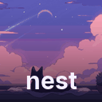
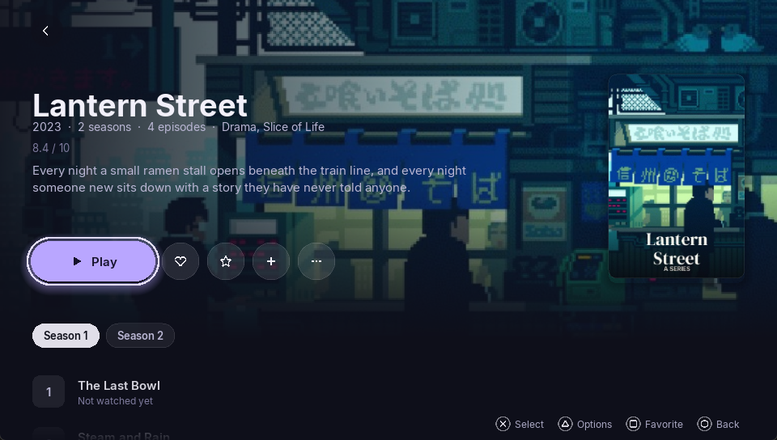
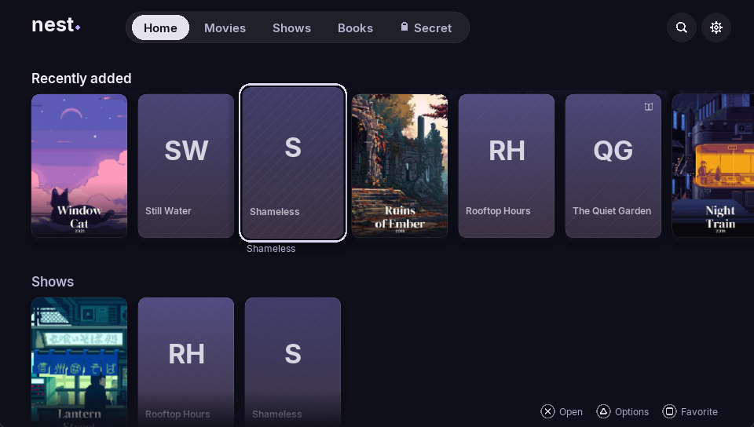

  

<h1 align="center">Nest</h1>

<b>I turned my PS Vita into a tiny Netflix. No subscription, no ads, no "are you still watching?"</b>

  
  
  

Hi 👋

So here's the story. I was in bed, scrolling through 40 files called `Show.S01E07.720p.WEB-DL.x264-FINAL-v2.mp4` in the Vita's video app, trying to work out which episode I was on. Somewhere around file 23 I decided I'd rather spend weeks writing an entire app than ever do that again.

That app is **Nest**. You throw your shows, movies and manga on your memory card, and it turns them into a library that looks like a real streaming service. The Vita has a gorgeous OLED screen; it deserves better than a list of file names.

## What's inside

🎬 **It looks like an actual app.** Big artwork, show logos, *Continue Watching*, *Up Next*, season tabs. Your friends will ask what app that is. You can say you made it. I won't tell.

🧠 **It sorts everything for you.** Nest reads the file names and works out what's a **movie** and what's a **show**, then puts every episode in the right season. Even the cursed ones with `1080p.BluRay.x264.YIFY` glued to the end. Especially those.

🖼️ **Real posters and logos.** The free **Nest Metadata** app for your PC fetches the actual poster, logo, backdrop and description for every show and movie. Drag your folder onto it, grab a drink, and come back to a library that looks expensive.

🔒 **A private section.** There's a **Secret** tab behind a PIN for your more… *personal* "shows". 👀 It stays hidden everywhere else in the app. We don't judge. We don't ask. We genuinely don't want to know.

📖 **It reads too.** Manga, comics, PDFs, ePubs. Right-to-left for manga, two-page spreads, and a long-strip mode for webtoons, so you can read "just one more chapter" at 3am like a responsible adult.

⏭️ **All the little things.**
- Skip intro: mark it once per show, then press R forever.
- It remembers where you stopped, even if you fall asleep mid-episode. Especially then.
- Subtitles and picture size, saved per show.
- A "your year" recap, so you can find out exactly how many hours went into that one anime. You may not want to know.
- A storage page that politely points out which show is eating your memory card.
- 16 cozy pixel-art lofi scenes moving behind your library, because vibes are a feature.

📡 **Watch from your PC** over Wi-Fi *(beta)*. For when your memory card says "no more" and your PC says "I've got you".

<table>
  <tr>
    <td></td>
    <td></td>
  </tr>
</table>

## Get it running (about 2 minutes, I timed it)

1. Download **[Nest.vpk](https://github.com/CHROMEVOID/nest-vita/releases/latest)** and install it with **VitaShell**. You need a homebrew-enabled Vita; [vita.hacks.guide](https://vita.hacks.guide) walks you through it, and it's easier than it sounds.
2. Open Nest, pick the folder your videos live in, and go make a snack while it scans.
3. *(Optional, but honestly do it)* Download **Nest-PC-Tools.zip** from the same page, double-click **Nest Metadata**, and drag your folder in. This is the bit that makes it look like the screenshots.

**One catch:** the Vita only plays **MP4 (H.264 + AAC)**. That's Sony's rule from 2011, not mine; please direct complaints to them. The [guide](docs/GUIDE.md#getting-your-videos-ready) has the one HandBrake setting that fixes it.

**→ [The full guide](docs/GUIDE.md)** covers folder layout, posters, streaming from your PC, controls and fixes for when things get weird.

## Say hi

Something broken? [Open an issue](https://github.com/CHROMEVOID/nest-vita/issues) and I'll fix it. I'm one person with a Vita and too much free time, so be nice 🙂

And if you set it up, I'd genuinely love to see your library. Tag me on TikTok **[@chr0m3void](https://www.tiktok.com/@chr0m3void)**. Nothing from the Secret tab, please.

---

Made with too much coffee by <b>chromevoid</b> · <a href="https://www.tiktok.com/@chr0m3void">TikTok @chr0m3void</a> · <a href="LICENSE">MIT</a> 
Nest plays files you already have. It doesn't download or share anything. Metadata comes from <a href="https://www.themoviedb.org">TMDB</a> (not endorsed by TMDB).

